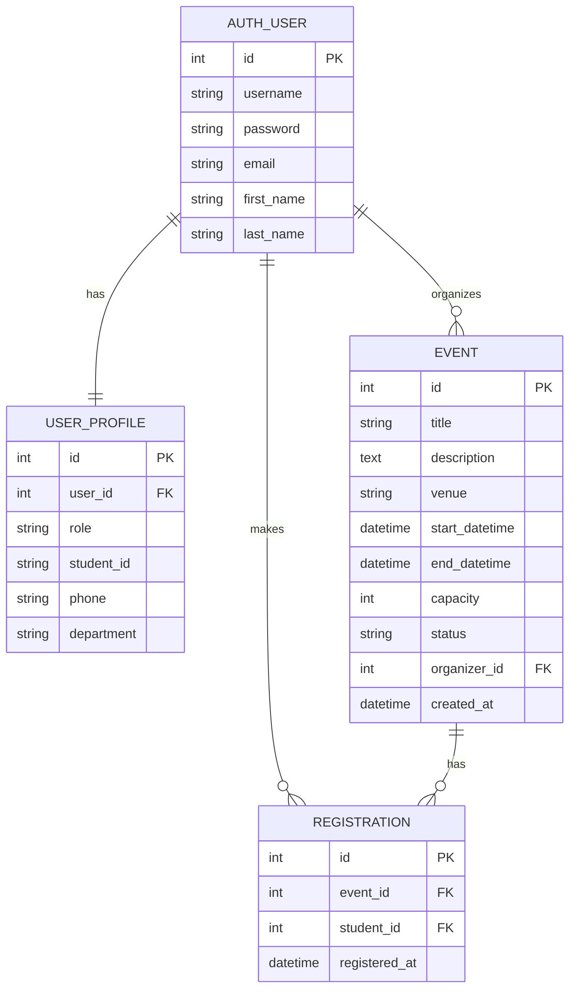

# CIS Event Management System

University group project (CIS).

**GitHub owner:** [Syed-Irtiza89](https://github.com/Syed-Irtiza89)

Stack: **Python, Django, Django ORM, PostgreSQL**

This repository is for **all team members**.  
Student 1 already added the **database part**. Other members will add pages, login, and extra tests on top of these models.

**Read [TEAM.md](TEAM.md) before you start coding.** That file tells you who can edit which files, how to make a branch, and how to use the models.

---

## What this system should do

- Student users and organizer users (Django login)
- Events with details, capacity, and status
- Event registration
- Stop duplicate registration
- Show how many people already registered

---

## Current status

| Part | Status | Who |
|---|---|---|
| Database models | Done | Student 1 |
| PostgreSQL settings | Done | Student 1 |
| Sample data | Done | Student 1 |
| Model tests | Done | Student 1 |
| Django admin | Done | Student 1 |
| Student / organizer website pages | Not done yet | other members |
| Login / signup pages | Not done yet | other members |

Admin panel already works after setup: http://127.0.0.1:8000/admin/

---

## Team members

Full rules: **[TEAM.md](TEAM.md)**

| Student | Role | GitHub |
|---|---|---|
| Student 1 | Database Developer | Syed-Irtiza89 |
| Student 2 | Frontend (pages / UI) | add username |
| Student 3 | Auth / extra backend | add username |
| Student 4 | Testing / documentation | add username |

---

## Clone the project (every member)

1. Accept the GitHub invite
2. Open PowerShell

```powershell
cd Desktop
git clone https://github.com/Syed-Irtiza89/CIS-Event-Management-System.git
cd CIS-Event-Management-System
```

If the clone URL is different, copy it from the green **Code** button on GitHub.

---

## Windows setup (every member)

### 1) Software

- Python 3.12
- Git
- PostgreSQL (install it, remember the `postgres` password, keep port `5432`)

Create the database one time in **SQL Shell (psql)** or pgAdmin:

```sql
CREATE DATABASE cis_event_db;
```

### 2) Python packages

```powershell
python -m venv venv
.\venv\Scripts\activate
pip install -r requirements.txt
```

### 3) Your local password file

Each student makes their own `.env`. **Do not upload `.env` to GitHub.**

```powershell
copy .env.example .env
notepad .env
```

```
DB_NAME=cis_event_db
DB_USER=postgres
DB_PASSWORD=your_postgres_password
DB_HOST=localhost
DB_PORT=5432
```

### 4) Create tables + sample rows

```powershell
python manage.py migrate
python manage.py load_sample_data
python manage.py createsuperuser
python manage.py runserver
```

Sample users (password = `password123`):

- organizers: `organizer1`, `organizer2`
- students: `ali`, `sara`, `hamza`, `ayesha`

### 5) Tests (database)

```powershell
python manage.py test events
```

If PostgreSQL is not ready and you only want to try tests:

```powershell
$env:USE_SQLITE="1"
python manage.py test events
```

Real project database is still PostgreSQL.

---

## File structure

```
CIS-Event-Management-System/
  README.md                 # start here
  TEAM.md                   # collaboration rules
  requirements.txt
  .env.example              # copy this, do not commit real .env
  manage.py
  cis_project/              # Django project
    settings.py             # PostgreSQL is configured here
    urls.py                 # add your app urls here (keep admin)
  events/                   # Student 1 database app
    models.py               # UserProfile, Event, Registration
    admin.py
    tests.py
    views.py                # empty on purpose
    management/commands/load_sample_data.py
    migrations/
```

Other members should add **new apps** (example: `pages`, `accounts`) instead of replacing `events/`.

```powershell
python manage.py startapp pages
```

Then add `'pages'` inside `INSTALLED_APPS` in `cis_project/settings.py`.

---

## Database design (Student 1)

### Entities

1. **User** - Django auth table (username / password)
2. **UserProfile** - student or organizer extra info
3. **Event** - event details, capacity, status
4. **Registration** - which student registered for which event

### Relationships

- One User has one UserProfile (OneToOne)
- One organizer User can create many Events (ForeignKey)
- One Event can have many Registrations (ForeignKey)
- One student User can have many Registrations (ForeignKey)
- Same student cannot register twice for the same event (UniqueConstraint)

### ER diagram



### Integrity rules

- `capacity` must be at least 1
- unique pair `(event, student)` in the database
- cancelled / completed events cannot take new registrations
- event cannot go over capacity
- only users with role `student` can register

---

## How to use models in your views

```python
from django.contrib.auth.models import User
from events.models import UserProfile, Event, Registration
from django.core.exceptions import ValidationError
```

Check role:

```python
profile = request.user.profile
if profile.role == "student":
    pass
if profile.role == "organizer":
    pass
```

List upcoming events:

```python
events = Event.objects.filter(status="upcoming")
```

Register (duplicate / full event raises ValidationError):

```python
try:
    Registration.objects.create(event=event, student=request.user)
except ValidationError as e:
    print(e)
```

Seats and participants:

```python
event.registered_count()
event.seats_left()
event.is_full()

for reg in event.registrations.select_related("student"):
    print(reg.student.username, reg.registered_at)

my_events = request.user.organized_events.all()
```

Need a new field? Ask Student 1. Do not edit `events/models.py` yourself.

---

## GitHub workflow (short)

```powershell
git checkout main
git pull
git checkout -b student2-frontend
# ... do your work ...
git add .
git commit -m "added event list page"
git push -u origin student2-frontend
```

Then open a **Pull Request** to `main` on GitHub.

More detail is in [TEAM.md](TEAM.md).

---

## Invite teammates (Student 1 / repo owner)

1. GitHub repo → **Settings** → **Collaborators** → **Add people**
2. Add each member GitHub username
3. They must accept the invite

---

## Do not put on GitHub

- `.env` (passwords)
- `venv/` folder
- your laptop PostgreSQL password
